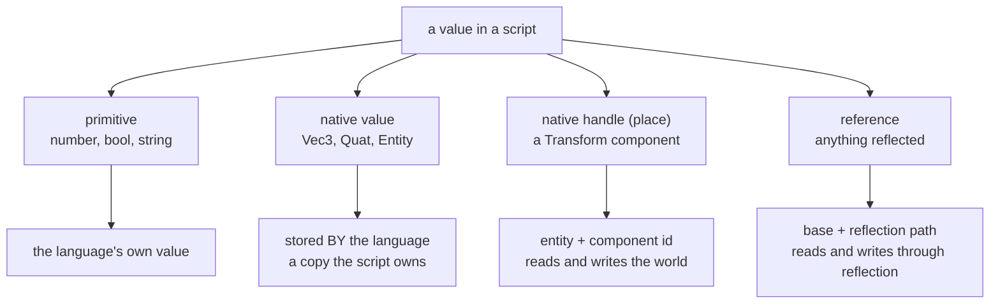
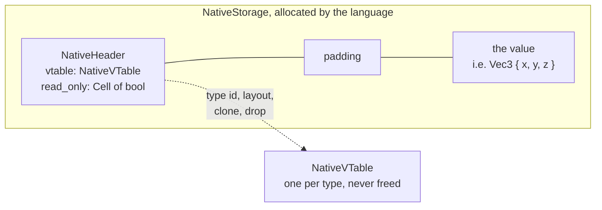
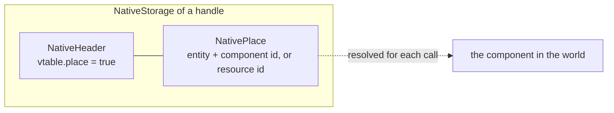
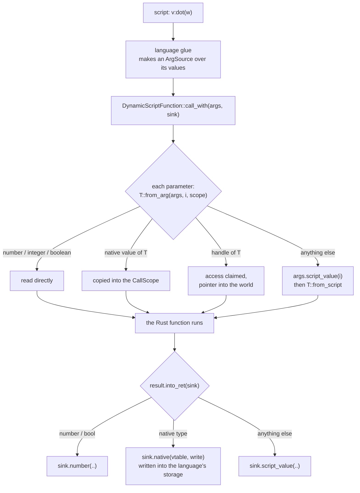
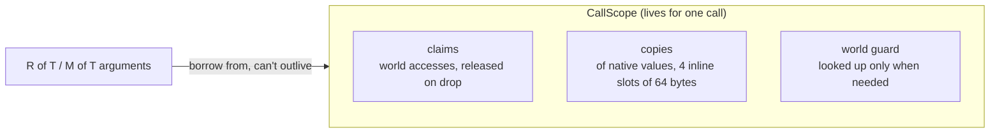
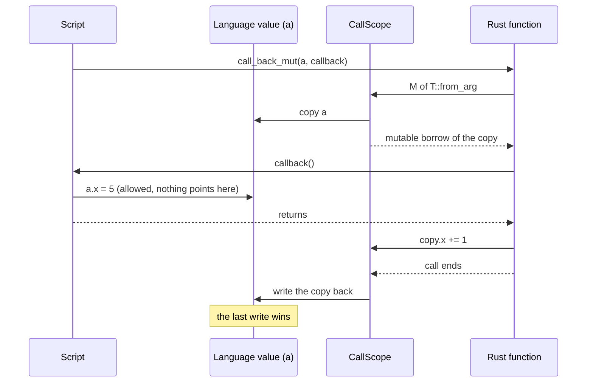
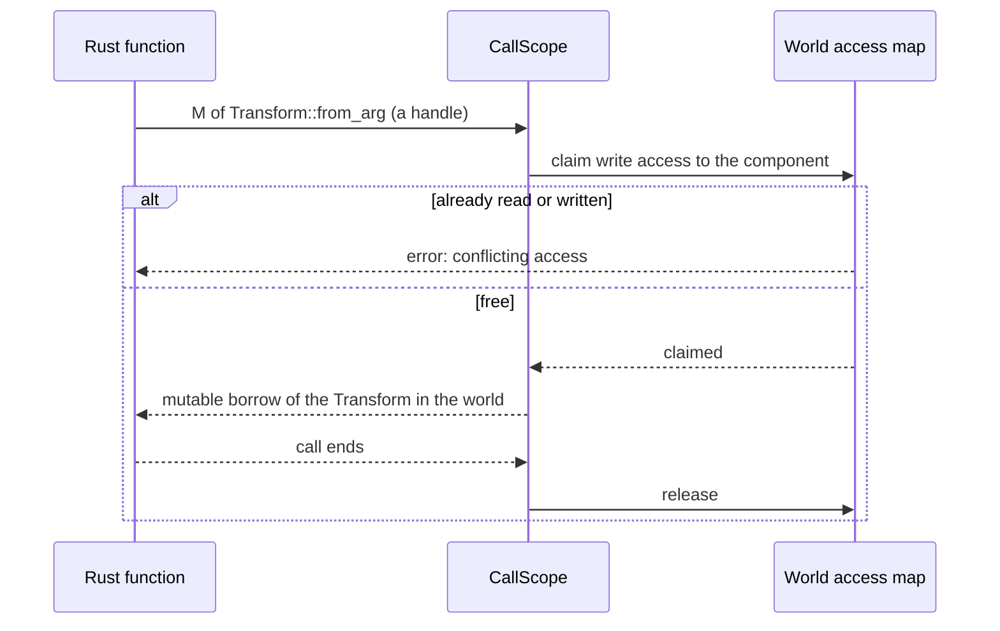
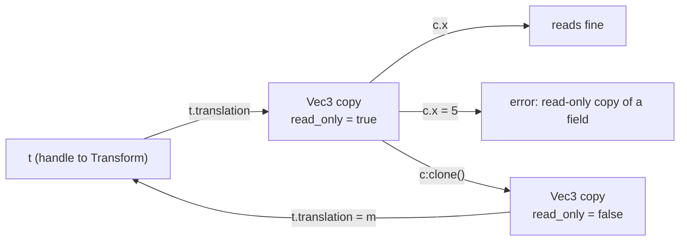

# Language Internals

How a script value reaches a Rust function and back, and why that is both fast and safe. This page is what every language shares, the language pages are what each does with it:

- [Lua](./lua.md): raw userdata and C closures on the Lua stack
- [LuaJIT](./luajit.md): cdata and FFI calls the JIT compiles
- [Rune](./rune.md): `Any` values and protocols

## What a script holds

Every value a script has is one of four things. Which one decides how fast it is and what a write does.



| | Where the data is | A read | A write |
|---|---|---|---|
| Primitive | the language | free | free |
| Native value | the language (`script_native!` types) | a typed accessor, or in place | changes the script's copy |
| Native handle | the world | claims access, reads the component | claims access, writes the component |
| Reference | the world or an allocation | reflection | reflection |

Native types are **values**: there is no write-through. A native field (`t.translation`) is read as a **read-only copy**, so `t.translation.x = 5` is an error instead of a lost write, and `t.translation = v` writes the whole field.

## A native value in memory

A language stores a native value as a header followed by the value. The header is how a typed function knows what it was given.



A handle uses the same storage with the type's *place* vtable, and a `NativePlace` where the value would be:



## How a call works

Functions never see the language. They read arguments from an `ArgSource` and write the result to a `ReturnSink`, which each language implements over its own values.



The slow arm is always there: a function works with every language and every argument, the fast arms only skip building `ScriptValue`s.

```rust,ignore
pub unsafe trait ArgSource {
    fn number(&self, i: usize) -> Option<f64>;
    fn native(&self, i: usize) -> Option<*mut u8>;           // base of a NativeStorage
    fn plain(&self, i: usize, ty: TypeId) -> Option<(*mut u8, bool)>; // no header (LuaJIT cdata)
    fn script_value(&self, i: usize) -> Result<ScriptValue, InteropError>; // the slow path
    // integer, boolean, string, list, map ..
}
```

## Safety: the CallScope

Every call runs in a `CallScope`. It owns everything a call borrows, and gives it all back when the call ends, also when the function panics.



### Script-owned values are copied

A script can write a value it owns at any time, also *while* a call holds it (a callback back into the script). So a call never points into the script's value: `R<T>` and `M<T>` point to the scope's copy, and `M<T>` is written back when the scope ends.



A copy is a `memcpy` for plain types and the vtable's `clone` for the others. `V<T>` needs no scope copy at all: it's read once.

### World values are claimed

A handle or reference points into the world, where systems and other arguments may point too. The scope claims read or write access to the component for the call, and conflicting claims are errors.



### Read-only copies

Reading a native field returns a copy with `read_only` set in its header. Passing it as `M<T>`, or writing one of its fields, is an error.



### The slow path of a native value

Anything untyped (a `ScriptValue` parameter, reflection, `tostring`) gets a reference to a fresh copy of the value. Write access to such a copy is refused, so a change is never silently lost.

## What makes it fast

| Cost | Avoided by |
|---|---|
| Building a `ScriptValue` per argument | `ArgSource` reads the language's value directly |
| An allocation per returned vector | the language stores the value (`ReturnSink::native`) |
| Reflection for `v.x` | typed accessors, or the field read in place (`DirectField`) |
| Looking up the world per call | lazy scopes: `CallScope::with_lazy` only finds the world when an argument needs it |
| Registry locks per result | each function caches the native types it returns (`NativeReturnType`) |

Native types and their functions are registered before any script runs: languages look them up once and keep them.
