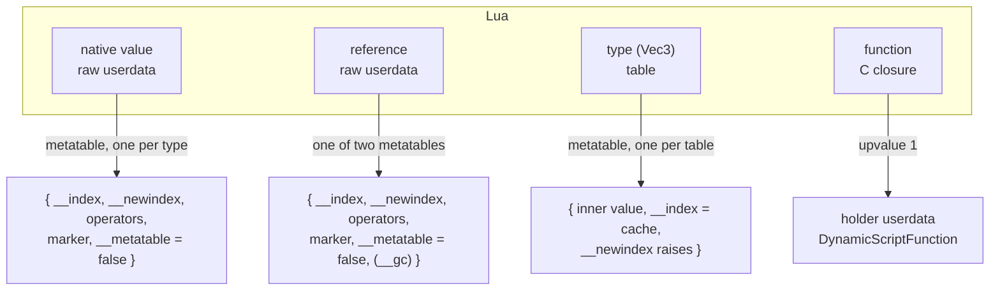
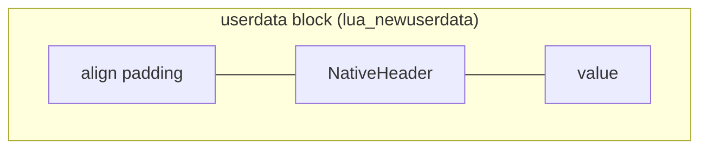
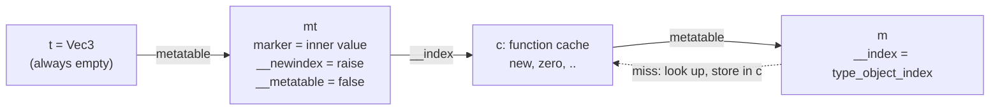
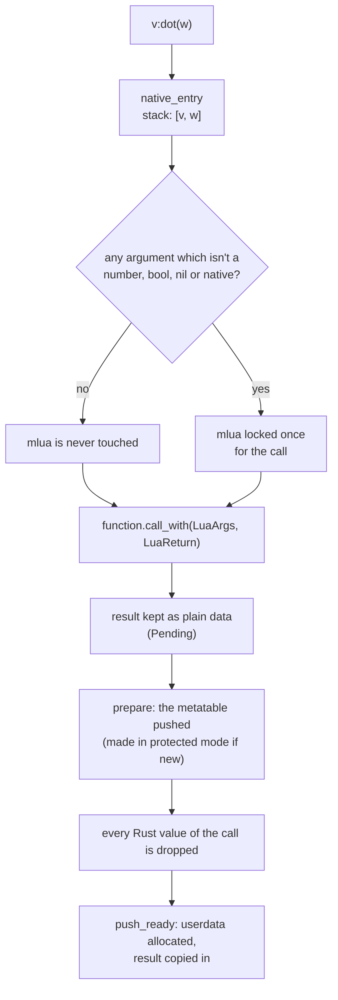
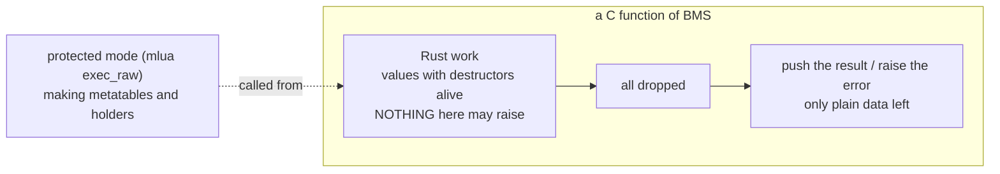
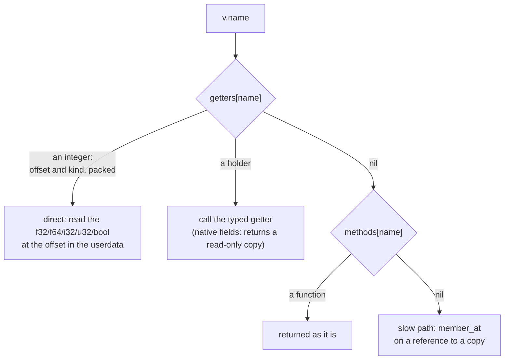
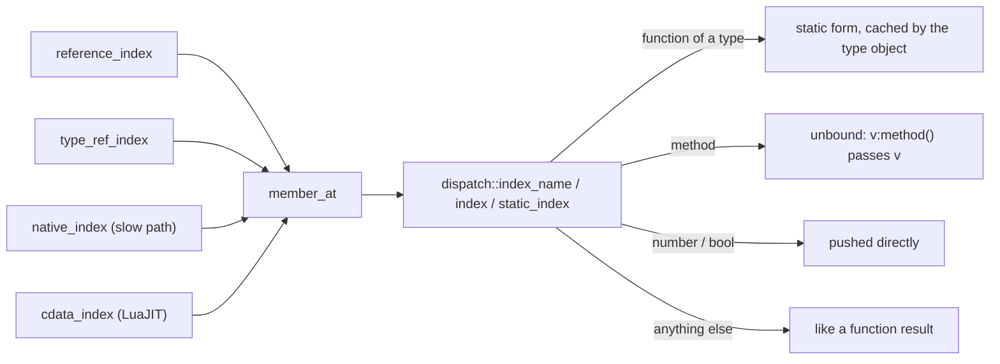
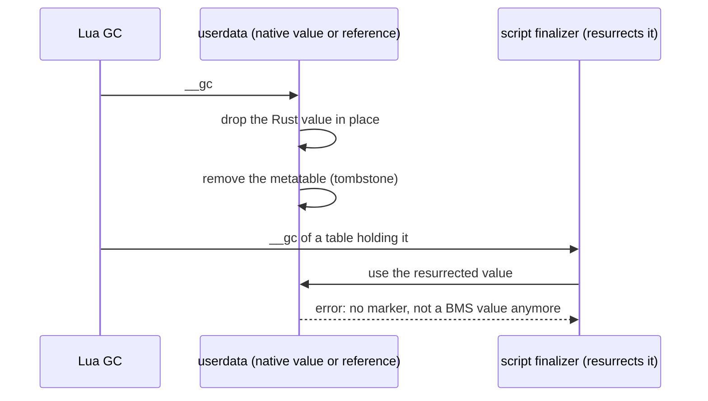

# Lua

How the Lua glue implements the [shared model](./introduction.md). The code is in `bevy_mod_scripting_lua/src/bindings/native.rs`. On LuaJIT, some native values are cdata instead, see [LuaJIT](./luajit.md).

mlua owns the state, loads scripts and calls into Lua. The hot paths below go around it, with the raw C API.

## What each value is in Lua



Values are told apart by a **marker** in their metatable, keyed by a light userdata. Lua code can't make light userdata and can't reach these metatables (`__metatable` is `false`), so only BMS' values have it.

### Native values



Lua only aligns userdata to its own maximum, so the block has room to round up (`align_up`).

### References

A `ReflectReference` written into a raw userdata, no box. There are two metatables: references to whole components and resources own no heap memory, so theirs has no `__gc`, which makes collecting them much cheaper.

### Types

`Vec3` is an empty table. The functions found through it are kept in the table which is its `__index`, so `Vec3.new` is a plain field after the first lookup.



`t` stays empty so every write reaches `__newindex`.

## A function call

A registered function is a C closure (`native_entry`) reading its arguments off the stack where they are.



Arguments stay on the stack for the whole call, so nothing they point to can be collected.

### Errors are `longjmp`s

A Lua error jumps over the C frames between the raise and the `pcall`. A Rust destructor in between would be skipped. So everything which can raise runs in one of two places:



```rust,ignore
unsafe fn run(l: *mut lua_State, f: impl FnOnce() -> Result<Ready, InteropError>) -> c_int {
    let ready = match catch_unwind(AssertUnwindSafe(f)) {
        Ok(Ok(ready)) => ready,
        Ok(Err(error)) => unsafe { raise(l, error) },       // nothing left to drop
        Err(payload) => unsafe { resume_panic(l, payload) }, // like mlua's callbacks
    };
    unsafe { push_ready(l, ready) } // plain values only
}
```

## Reading a field

`__index` of a native value tries the cheapest thing first.



`__newindex` mirrors it: a direct field is written in place unless the value is read-only or the new value isn't a number, in which case the typed setter produces the error.

The direct path trusts that the value at index 1 is a userdata of this type. That holds because the function is only reachable as the `__index` of this metatable, which scripts can't get.

## Member lookup

Every `__index` slow path ends in one function, `member_at`:



## Lists, maps and strings

Typed parameters read tables off the stack without building `ScriptValue`s:

| Parameter | Read as |
|---|---|
| `String` | borrowed from the Lua string, copied once |
| `Vec<T>` | a sequence (keys exactly `1..=n`): the items are pushed and stay on the stack for the call, each read with `T::from_arg` |
| `HashMap<String, V>` | string keys only: each value is read then popped, so native values in it aren't handed out as pointers (`NoNatives`) |

Anything else (holes, mixed keys) takes the slow path and converts as before.

## Garbage collection



A panicking destructor is caught: nothing unwinds through the collector. On Luau, userdata destructors (`lua_newuserdatadtor`) do the same job.

## Safety checklist

| Risk | Guard |
|---|---|
| A foreign userdata read as a native value | marker in a metatable scripts can't reach |
| `longjmp` skipping a Rust destructor | raise only once everything is dropped, or in protected mode |
| A script writing a value a call holds | calls get copies ([CallScope](./introduction.md#safety-the-callscope)) |
| Use after `__gc` | tombstones |
| Stack overflow | `lua_checkstack` before every push which isn't covered by `LUA_MINSTACK` |
| Out of memory while pushing | allocation outside protected mode only when mlua says it can't fail (no memory limit set) |

The `debug` library reaches every metatable and upvalue, and bytecode (`load`) isn't verified by the VM: none of this holds for scripts which have either. mlua's safe state doesn't load `debug`, but does allow bytecode, see [Sandboxing](../../Summary/customizing-script-contexts.md#sandboxing).
