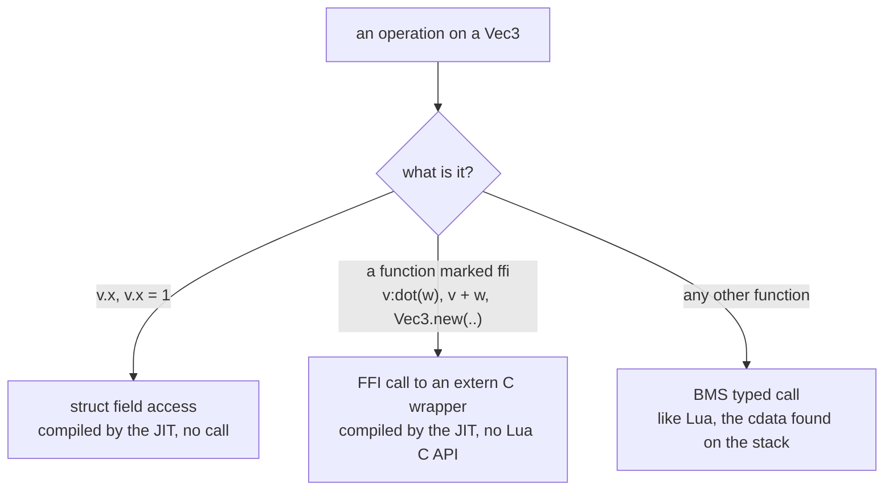
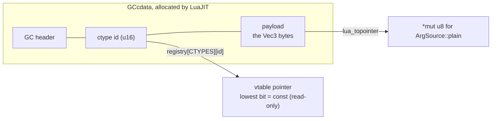
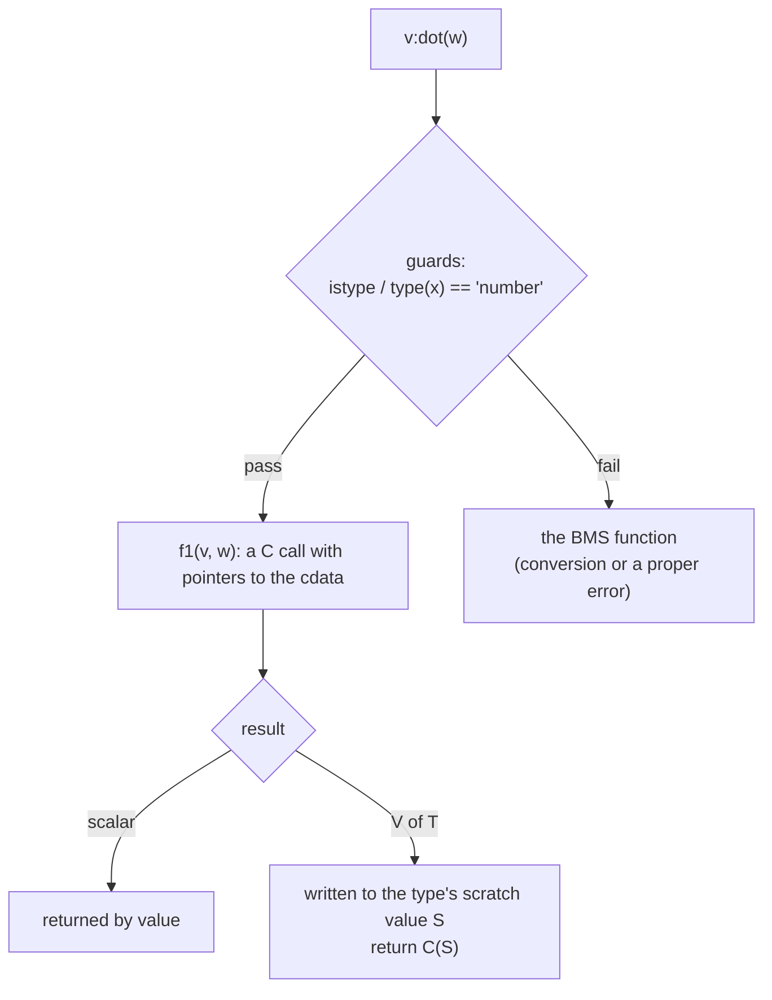
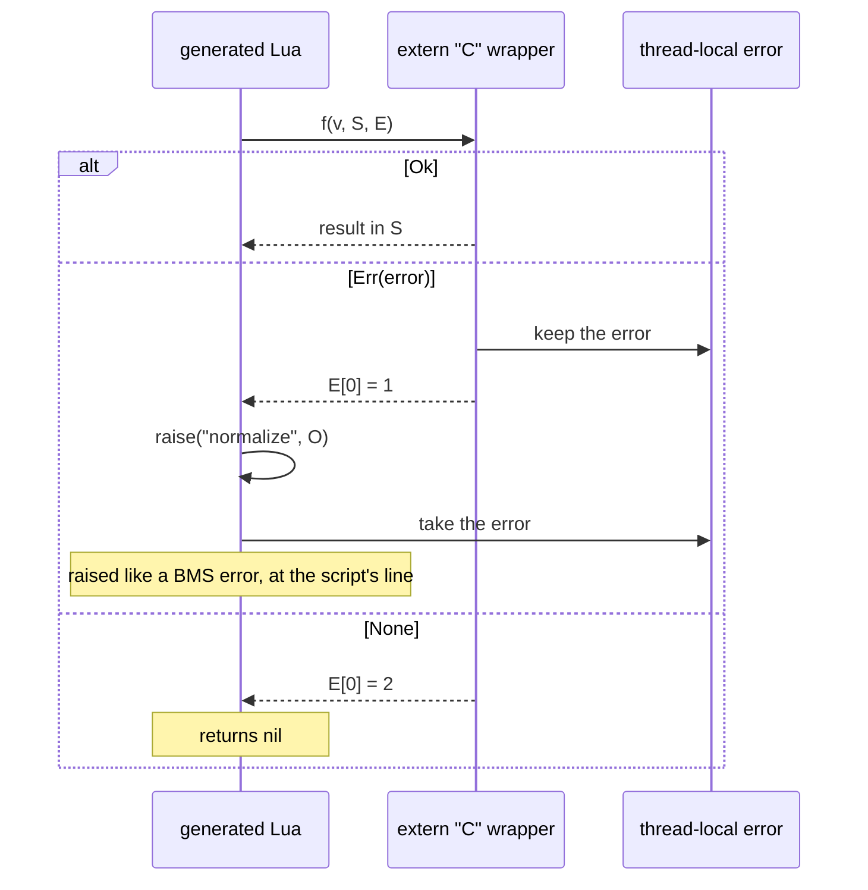
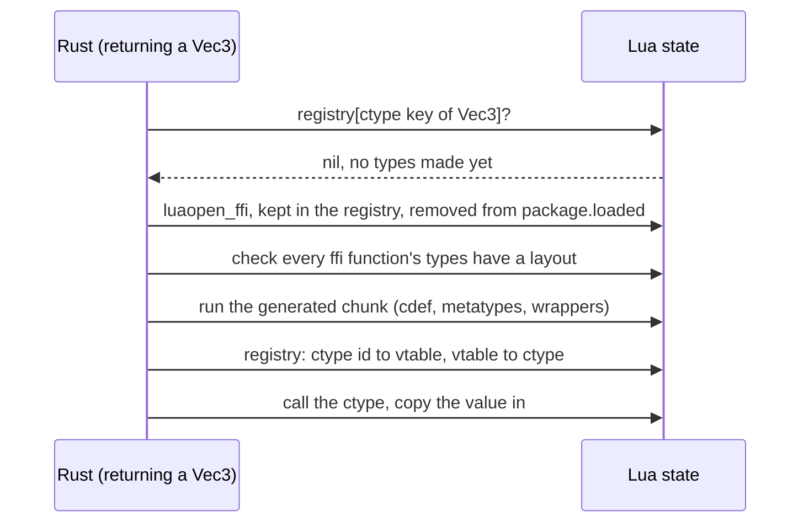

# LuaJIT

On LuaJIT, native types with a C layout are **cdata**: C structs LuaJIT allocates itself, whose field accesses and FFI calls its JIT compiles to machine code. Everything else is as in [Lua](./lua.md). The code is in `bevy_mod_scripting_lua/src/bindings/native/cdata.rs`.

## Three speeds



## Declaring a layout

```rust,ignore
// compile time: `Copy`, and the size and alignment of the C struct of these fields
assert_ffi_layout!(Vec3 { x: f32, y: f32, z: f32 });
// Safety: the fields are at their offsets, and any bits in them are a valid Vec3
unsafe {
    NativeType::of::<Vec3>()
        .field("x", offset_of!(Vec3, x), |v| &v.x)
        .field("y", offset_of!(Vec3, y), |v| &v.y)
        .field("z", offset_of!(Vec3, z), |v| &v.z)
        .ffi()              // the fields so far, in order, are the C struct
        .register(world);
    // SIMD types reach their fields through Deref: the offsets are measured in the default value
    NativeType::of::<Vec3A>()
        .deref_field("x", |v| &v.x)
        .deref_field("y", |v| &v.y)
        .deref_field("z", |v| &v.z)
        .ffi()
        .register(world);
}
```

`ffi` is an `unsafe` contract of its own: scripts can write every byte of a cdata, so every bit pattern of the fields must be a valid value (a vector, not a normalised direction). It panics when the type is declared if the fields aren't where the C struct puts them; `assert_ffi_layout!` moves the size and alignment part to compile time. Each Lua state then declares:

```c
typedef struct __attribute__((aligned(16))) {
    float x; float y; float z;
    uint8_t _pad12; uint8_t _pad13; uint8_t _pad14; uint8_t _pad15;
} bms_glam__f32__sse2__vec3a__Vec3A;   // named after the type's path
```

Two rules keep scripts from getting a pointer:

- **Padding is one scalar per byte.** An array field would be read as a reference, which LuaJIT doesn't bounds-check.
- **Fields of native types are flattened** (`Mat3.x_axis` is `_x_axis_x`, `_x_axis_y`, `_x_axis_z`). A nested struct field would be read as a reference into the matrix, which doesn't keep it alive. `m.x_axis` is a generated getter returning a `const` copy instead.

Fields which aren't `f32`, `f64`, `i32` or `u32` (a `bool`, where not every bit pattern is valid) keep the type a userdata.

## Recognising a cdata

Rust is handed a cdata by BMS functions which aren't FFI calls. It must know the type without trusting the script.



Scripts can write every byte of the payload but not the ctype id. Ids which aren't in the table (`1LL`, any other cdata) aren't native values. Where the id sits depends on the LuaJIT build, so it's found once from a probe value of a known type.

A read-only copy is the `const` form of the struct: LuaJIT itself refuses writes to it, also in compiled code.

## An FFI function

An FFI form is registered next to a function, from a Rust function doing the same with C types:

```rust,ignore
registry.register_ffi(TypeId::of::<Vec3>(), "dot", |a: R<Vec3>, b: R<Vec3>| a.dot(*b));
```

`#[ffi]` in a `#[script_bindings]` block is exactly that call, with the function's body as the closure:

```rust,ignore
#[script_bindings(remote, namespace = "math")]
impl Vec3 {
    #[ffi]
    fn dot(_self: R<Vec3>, other: R<Vec3>) -> f32 { _self.dot(*other) }
}
```

The `extern "C"` function is made by a trait, `FfiFn`, implemented for functions which capture nothing (so the function is its type, and the trampoline needs no pointer to it):

```rust,ignore
unsafe impl<Function, Return, A1, A2> FfiFn<fn(A1, A2) -> Return> for Function
where Function: Fn(A1, A2) -> Return + Copy + 'static, Return: FfiReturn, A1: FfiArg, A2: FfiArg
{
    fn ffi_function(self, name: &'static str) -> FfiFunction {
        extern "C" fn trampoline<..>(a1: A1::C, a2: A2::C, out: *mut u8, failed: *mut u8) -> Return::C {
            let function: Function = /* zero-sized: conjured */;
            let output = function(unsafe { A1::from_c(a1) }, unsafe { A2::from_c(a2) });
            unsafe { output.into_c(out, failed) }
        }
        FfiFunction { name, function: trampoline::<..> as *const (), params: vec![A1::kind(), A2::kind()], .. }
    }
}
```

### One form per C signature

A `Union<R<Vec3>, f32>` parameter is a pointer or a float in the same position: two C types, so two signatures. One signature for both would need a struct passed by value, which LuaJIT doesn't compile. So `Union` is no FFI parameter, and a function taking one registers a form for each alternative:

```rust,ignore
// fn add(_self: R<Vec3>, rhs: Union<R<Vec3>, f32>) -> V<Vec3>   <- not marked #[ffi]
registry.register_ffi(TypeId::of::<Vec3>(), "add", |a: R<Vec3>, b: R<Vec3>| V(*a + *b));
registry.register_ffi(TypeId::of::<Vec3>(), "add", |a: R<Vec3>, b: f32| V(*a + b));
```

The forms of one name chain: each checks its own argument types and falls through to the one registered before it, then to the BMS function.

Each state generates Lua around the pointer:

```lua
local f1, other = cast("float (*)(const bms_Vec3*, const bms_Vec3*, void*, uint8_t*)", ptrs[1]), slow["dot"]
local function w(a1, a2)
    if istype(C1, a1) and istype(C1, a2) then return f1(a1, a2, nil, nil) end
    return other(a1, a2) -- any other argument: through BMS, which reports the error
end
methods["dot"] = w
```



What can cross is decided by traits, at compile time:

| | Types | Passed as |
|---|---|---|
| `FfiArg` | `f32`, `f64`, `i32`, `u32`, `bool` | by value |
| | `R<T>`, `V<T>` | `const T*` to the cdata |
| `FfiReturn` | scalars | returned |
| | `V<T>` | written to the out-pointer |
| | `Result<_, InteropError>`, `Option<_>` | as above, failure through the `failed` byte |

There is no `M<T>`: an FFI function never writes its arguments. And no `Union`: see above.

### Why a scratch value

A result cdata passed to C as an out-pointer escapes, so the JIT must allocate it. Writing to a per-type scratch value and copying it in Lua (`C(S)`) lets the JIT remove the allocation when the result is only used for more arithmetic.

### Failing

C functions called through the FFI can't raise Lua errors.



## The slow path

A cdata passed to a BMS function is found by its ctype id and copied into the [CallScope](./introduction.md#safety-the-callscope) like any native value; `M<T>` is written back to the payload when the call ends. A value returned by BMS is copied into a new cdata made by calling the ctype.

## The first value in a state



Types are made once per state. A type registered later stays a userdata there.

## Views

`world.get_component` and `world.get_resource` return a view instead of a reference (`ViewRef`, `ReturnSink::view`; code in `native/views.rs`): a cdata of `const` fields holding the component's address, its changed tick, and the two epochs it was made in. Its metatype is Lua generated per type, so accesses compile:

```lua
__index = function(h, k)
  local s = cast(S, h)                                        -- not h's `const` fields: LuaJIT reuses their loads across calls
  if s.e ~= L[0] or s.g ~= G[0] then                          -- an epoch changed: find the component again
    if not REFRESH(s, L) then gone() end                      -- FFI: row_view by entity + component id, rewrites s
  end
  local g = getters[k] if g ~= nil then return g(cast(P, s.p)) end
  local m = methods[k] if m ~= nil then return m end
  return index(h, k)                                          -- other fields: by reflection
end
getters["float"] = function(p) return p.f_float end           -- `P`: a C struct at the measured offsets
```

- **Layouts** are measured on the first live value through reflection (`bindings::view::view_layout`): scalar and native fields, aligned, inside the value, not overlapping, and the same offsets on a second value; the generated chunk asserts C agrees (`sizeof`, `offsetof`). Other fields go through a reference.
- **Epochs**: the structural one is bumped by every `with_world_mut_access` (the only way to `&mut World` from a guard); the state's one (`ViewEpoch`) when Rust enters and leaves its Lua code (`enter_script`). Views are only made while the state is the one entered on this thread, so an entry that isn't wrapped gets references, never unchecked views.
- **Access** is claimed and released when the view is made (`WorldAccessGuard::row_view`), with the archetype filter: no write access makes a read-only view (null tick). Setters write the context's change tick into the row.
- **Debug builds** also re-resolve the address through Bevy on every access (`view_check`), so a structural path missing its bump fails the tests instead of corrupting the world.
- A view passed to a typed function becomes the place of its component (claimed for the call), as on other Lua versions.

## Safety checklist

| Risk | Guard |
|---|---|
| Scripts making pointers, casts or their own ctypes | the `ffi` library is private: never a global, not `require`-able |
| A reference cdata into a value (dangling, unchecked indexing) | no array or struct fields in the C structs: padding and nested fields are scalars |
| An FFI function called with the wrong types | guards in the generated Lua before every FFI call |
| A layout which isn't the Rust type's | `ffi` checks size, alignment and offsets when the type is declared (`assert_ffi_layout!` at compile time), `sizeof`/`alignof` asserted in each state |
| A function which doesn't match its declared signature | made by the `FfiFn` trait from the Rust function's own types; registering a raw pointer is `unsafe` (`register_ffi_function`) |
| A script writing a cdata a call holds | calls get copies |
| A panic in an `#[ffi]` function | **aborts the process**: it can't unwind through C. Only mark functions which don't panic (no integer arithmetic, no indexing) |
| Rust reading a foreign cdata | ctype id lookup, unknown ids are refused |
| A view used after its component moved or was freed | both epochs checked before every access, bumped before every structural change and on every entry and exit; a changed epoch re-resolves the address |
| A view made or written without access | access claimed when it's made, read-only without write access |

Like on Lua, bytecode and the `unsafe_lua_modules` feature (which hands scripts `ffi`) void all of this, see [Sandboxing](../../Summary/customizing-script-contexts.md#sandboxing).

> LuaJIT with your crate at `opt-level = 1` and dependencies optimised segfaults when userdata is collected ([mlua#757](https://github.com/mlua-rs/mlua/issues/757)). Use `opt-level` 0, 2 or 3.
