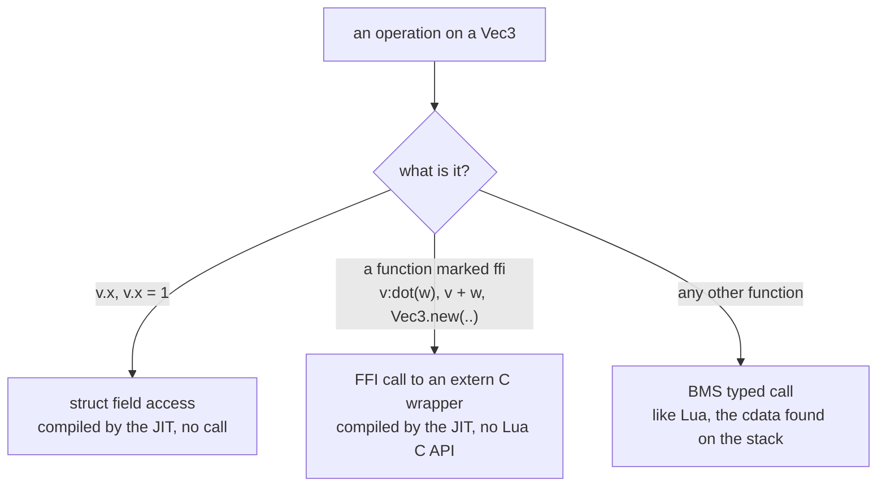
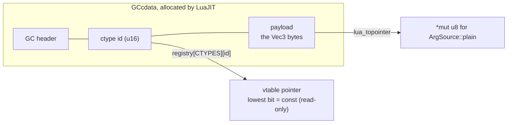
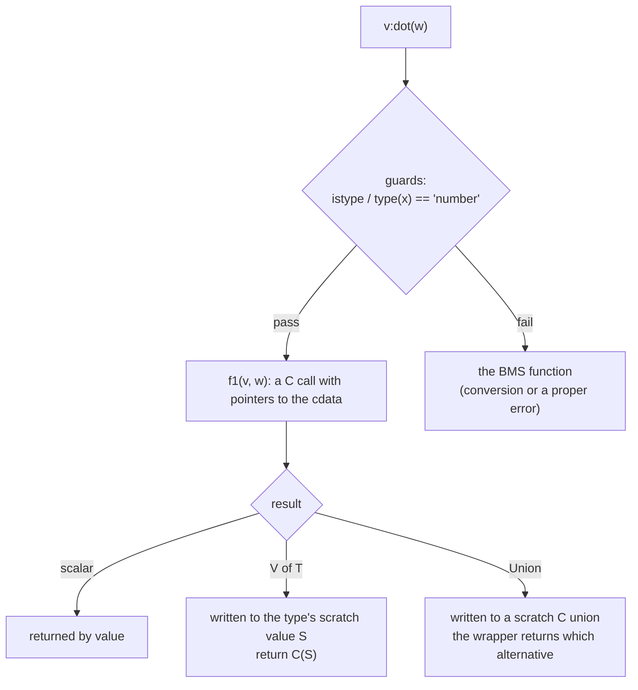
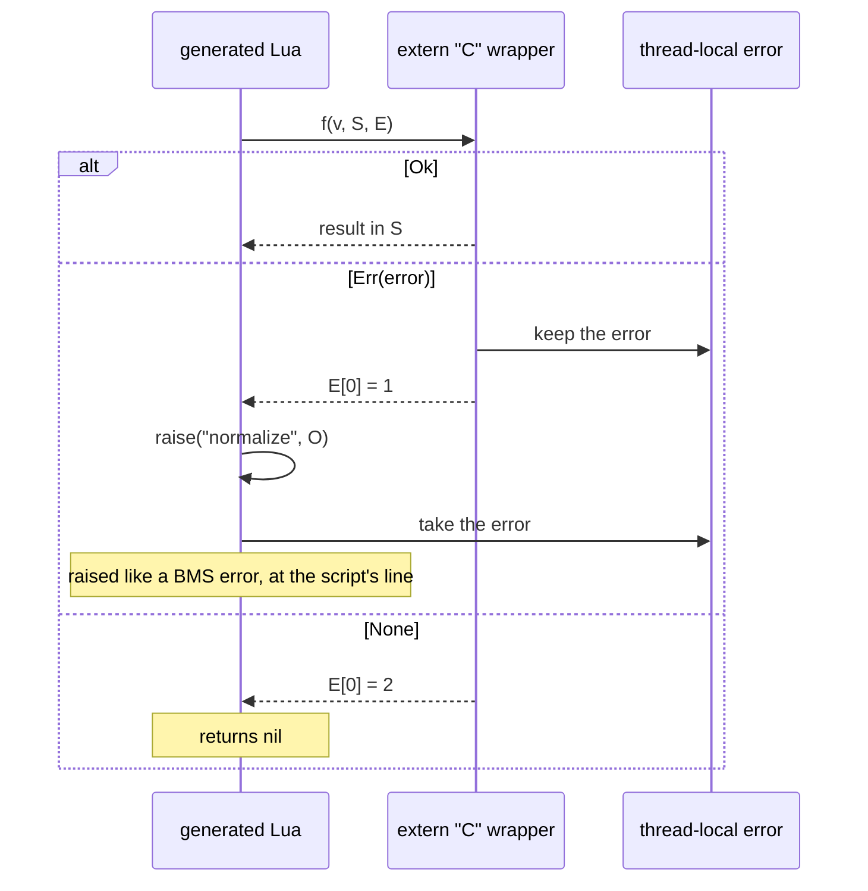
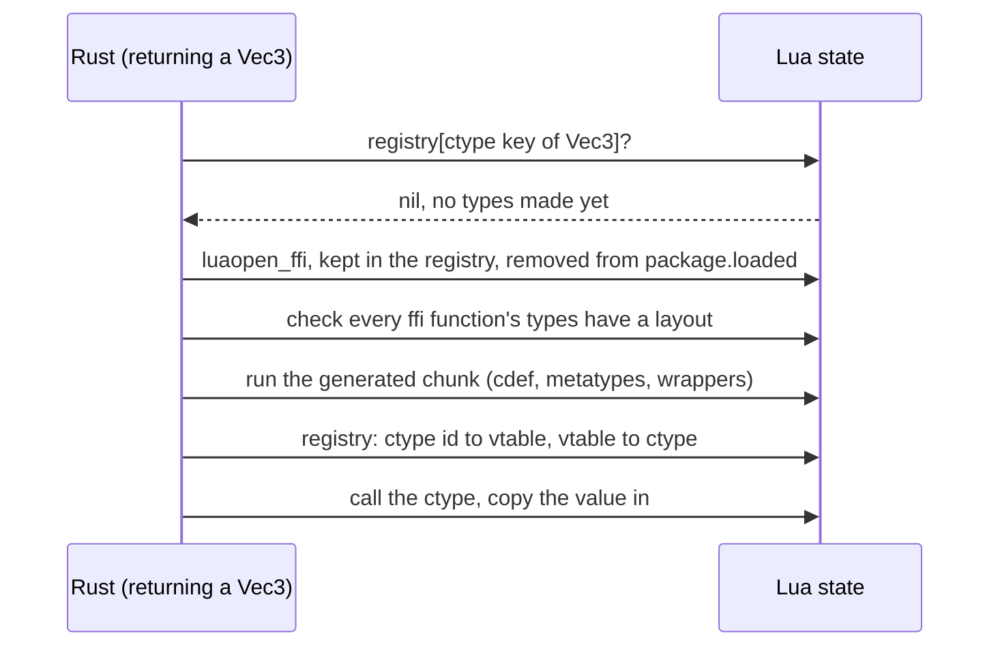

# LuaJIT

On LuaJIT, native types with a C layout are **cdata**: C structs LuaJIT allocates itself, whose field accesses and FFI calls its JIT compiles to machine code. Everything else is as in [Lua](./lua.md). The code is in `bevy_mod_scripting_lua/src/bindings/native/cdata.rs`.

## Three speeds



## Declaring a layout

```rust,ignore
script_native!(world, ffi Vec3 { x: f32, y: f32, z: f32 });
// SIMD types reach their fields through Deref: the offsets are measured in the default value
unsafe { script_native!(world, ffi deref Vec3A { x: f32, y: f32, z: f32 }) };
```

The `ffi` form checks at compile time that the type is `Copy` and that its size, alignment and field offsets are exactly those of the C struct of its fields. Each Lua state then declares:

```c
typedef struct __attribute__((aligned(16))) {
    float x; float y; float z;
    uint8_t _pad12; uint8_t _pad13; uint8_t _pad14; uint8_t _pad15;
} bms_Vec3A;
```

Two rules keep scripts from getting a pointer:

- **Padding is one scalar per byte.** An array field would be read as a reference, which LuaJIT doesn't bounds-check.
- **Fields of native types are flattened** (`Mat3.x_axis` is `_x_axis_x`, `_x_axis_y`, `_x_axis_z`). A nested struct field would be read as a reference into the matrix, which doesn't keep it alive. `m.x_axis` is a generated getter returning a `const` copy instead.

Fields which aren't `f32`, `f64`, `i32` or `u32` (a `bool`, where not every bit pattern is valid) keep the type a userdata.

## Recognising a cdata

Rust is handed a cdata by BMS functions which aren't FFI calls. It must know the type without trusting the script.



Scripts can write every byte of the payload but not the ctype id. Ids which aren't in the table (`1LL`, any other cdata) aren't native values. Where the id sits depends on the LuaJIT build, so it's found once from a probe value of a known type.

A read-only copy is the `const` form of the struct: LuaJIT itself refuses writes to it, also in compiled code.

## An `#[ffi]` function

```rust,ignore
#[script_bindings(remote, namespace = "math")]
impl Vec3 {
    #[ffi]
    fn dot(_self: R<Vec3>, other: R<Vec3>) -> f32 { _self.dot(*other) }
}
```

The derive adds an `extern "C"` wrapper next to the normal registration:

```rust,ignore
extern "C" fn wrapper(a0: *const Vec3, a1: *const Vec3, out: *mut u8, failed: *mut u8) -> f32 {
    let function = |_self: R<Vec3>, other: R<Vec3>| -> f32 { _self.dot(*other) };
    let output = function(unsafe { FfiArg::from_c(a0) }, unsafe { FfiArg::from_c(a1) });
    unsafe { FfiReturn::into_c(output, out, failed) }
}
```

and each state generates Lua around the pointer:

```lua
local f1, other = cast("float (*)(const bms_Vec3*, const bms_Vec3*, void*, uint8_t*)", ptrs[1]), slow["dot"]
local function w(a1, a2)
    if istype(C1, a1) and istype(C1, a2) then return f1(a1, a2, nil, nil) end
    return other(a1, a2) -- any other argument: through BMS, which reports the error
end
methods["dot"] = w
```



What can cross is decided by traits, at compile time:

| | Types | Passed as |
|---|---|---|
| `FfiArg` | `f32`, `f64`, `i32`, `u32`, `bool` | by value |
| | `R<T>`, `V<T>` | `const T*` to the cdata |
| | `Union<A, B>` | one wrapper per alternative |
| `FfiReturn` | scalars | returned |
| | `V<T>` | written to the out-pointer |
| | `Union<A, B>` | written to a C union, the index returned |
| | `Result<_, InteropError>`, `Option<_>` | as above, failure through the `failed` byte |

There is no `M<T>`: an FFI function never writes its arguments.

### Why a scratch value

A result cdata passed to C as an out-pointer escapes, so the JIT must allocate it. Writing to a per-type scratch value and copying it in Lua (`C(S)`) lets the JIT remove the allocation when the result is only used for more arithmetic.

### Failing

C functions called through the FFI can't raise Lua errors.



## The slow path

A cdata passed to a BMS function is found by its ctype id and copied into the [CallScope](./introduction.md#safety-the-callscope) like any native value; `M<T>` is written back to the payload when the call ends. A value returned by BMS is copied into a new cdata made by calling the ctype.

## The first value in a state



Types are made once per state. A type registered later stays a userdata there.

## Safety checklist

| Risk | Guard |
|---|---|
| Scripts making pointers, casts or their own ctypes | the `ffi` library is private: never a global, not `require`-able |
| A reference cdata into a value (dangling, unchecked indexing) | no array or struct fields in the C structs: padding and nested fields are scalars |
| A wrapper called with the wrong types | guards in the generated Lua before every FFI call |
| A layout which isn't the Rust type's | compile-time checks in `script_native!`, `sizeof`/`alignof` asserted in each state |
| A wrapper which doesn't match its declared signature | made by the derive; registering one by hand is `unsafe` (`register_ffi_function`) |
| A script writing a cdata a call holds | calls get copies |
| A panic in an `#[ffi]` function | **aborts the process**: it can't unwind through C. Only mark functions which don't panic (no integer arithmetic, no indexing) |
| Rust reading a foreign cdata | ctype id lookup, unknown ids are refused |

Like on Lua, bytecode and the `unsafe_lua_modules` feature (which hands scripts `ffi`) void all of this, see [Sandboxing](../../Summary/customizing-script-contexts.md#sandboxing).

> LuaJIT with your crate at `opt-level = 1` and dependencies optimised segfaults when userdata is collected ([mlua#757](https://github.com/mlua-rs/mlua/issues/757)). Use `opt-level` 0, 2 or 3.
