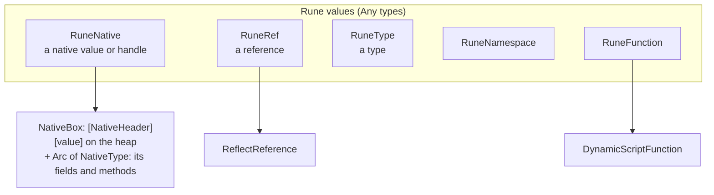
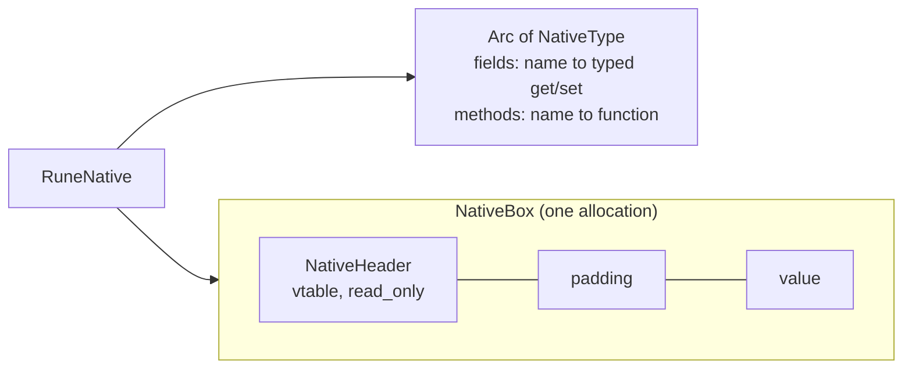
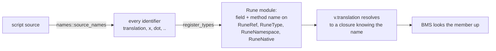
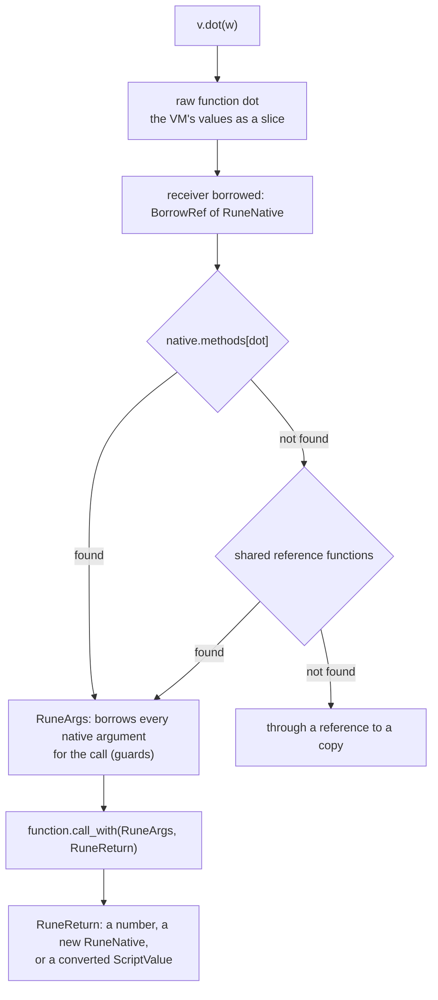
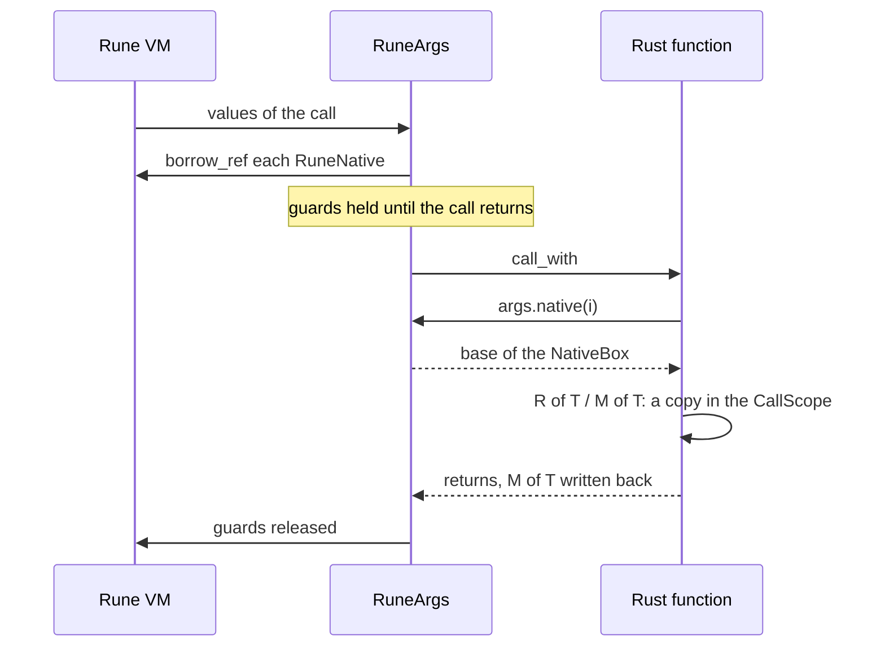
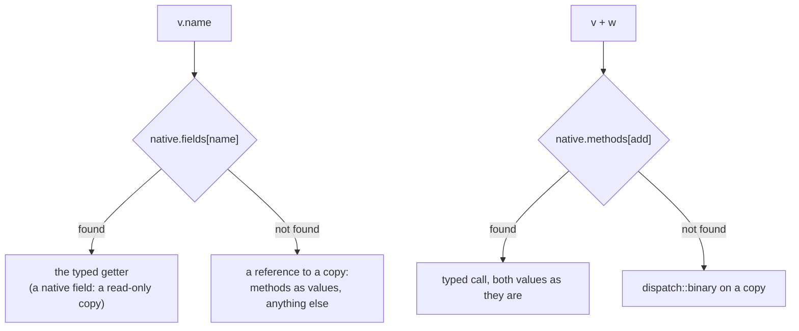

# Rune

How the Rune glue implements the [shared model](./introduction.md). The code is in `bevy_mod_scripting_rune/src/{types,native,names}.rs`.

Rune is a safe Rust VM: there is no stack to manage and no `longjmp`. Errors are `Result`s, values are reference counted and borrow checked at runtime. The glue is mostly about Rune's static member resolution.

## What each value is in Rune



A `RuneNative` keeps the `NativeType` it was made with, so reading a field or calling a method takes no registry lookup.



## Members are resolved by name hash

Rune looks `v.name` and `v.name()` up by the hash of the name, in a table fixed when the context is built, with no fallback for unknown names. So every identifier in the script's source is registered as a field and a method of each BMS type; whether the member exists is checked when it's used.



`v["name"]` goes through the index protocol, which gets the name as a value and needs no registration.

## A function call



The arguments of short calls stay in a stack array, longer ones use a `Vec`.

```rust,ignore
pub(crate) enum RuneArg<'a> {
    Value(&'a Value),       // a value of the VM
    Native(&'a RuneNative), // the receiver of a protocol, already borrowed
    Ref(&'a RuneRef),
}
```

### Guards

`ArgSource::native` hands out pointers into `NativeBox`es. Rune's own borrow tracking keeps them valid: every native argument is borrowed (`BorrowRef`) for the whole call, so nothing the call runs can take or drop the value.



The call still works on copies ([CallScope](./introduction.md#safety-the-callscope)): the guards keep the storage alive, the copies keep a callback's writes from aliasing a `&mut`.

## Fields and operators



`v.name += x` reads, applies the operator and writes: Rune has a protocol for each compound assignment. Equality with a value which is neither a native value nor a reference is `false` without a call.

## Compared to Lua

| | Lua | LuaJIT | Rune |
|---|---|---|---|
| Native storage | userdata | cdata (types with a C layout) | `NativeBox` in an `Any` |
| Field read | in place (`DirectField`) | compiled struct access | typed getter |
| Type's functions found | metatable, made once per state | generated Lua, made once per state | the value's `Arc<NativeType>` |
| Lists, maps, strings | read off the stack | read off the stack | converted (`ScriptValue`) |
| Errors | `longjmp`, raised last | same, FFI failures through a flag | `Result` |
| What keeps an argument alive | the stack | the stack | `BorrowRef` guards |

## Safety checklist

| Risk | Guard |
|---|---|
| A value dropped or taken while a call points to its storage | `BorrowRef` guards for the call; a failed borrow is an error |
| A script writing a value a call holds | calls get copies |
| Writing through a copy of a field | `read_only` in the `NativeHeader` |
| Unknown members | checked by BMS when used, every name resolves |

The only `unsafe` here is reading and writing `NativeStorage` through the vtable.
