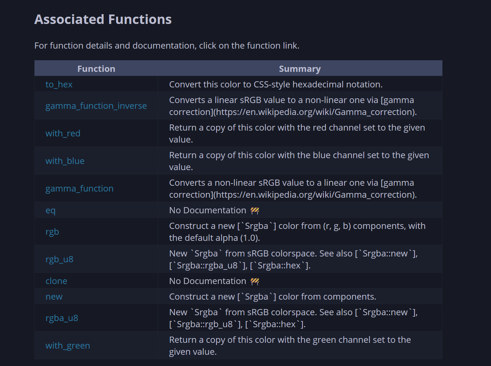

# Abandoning Codegen

Codegen has played a big role from the start for BMS, giving us great benefits, but mainly the ability to quickly 'sync' our scripting API with each new bevy release (instead of a manual review each time).

This was especially important before the introduction of a unified scripting function registry, which would have meant writing a version of each API per language.

However I believe that as Bevy is maturing the API's that people rely on are likely to be more stable than ever, and I have a hypothesis that a large majority of the generated bindings are simply left unused.

The other side of the coin is that codegen is somewhat problematic due to:
- Largely increased compilation times
- The need to stay in sync with the rustc codebase (the compiler internals we use to plug into the compilation)

I believe it's time to finally abandon this concept, and commit to hand writing a core scripting API over the important parts of bevy.

# Status Quo

A little context for those who are not aware of how codegen works in our case.

## Automatic Bindings

the code under `/codegen` contains crates which create a custom cargo executable (a driver and the entry point), which works with cargo to execute a custom rustc compilation, which on top of compiling and error checking the code, also runs our custom hooks.

In these hooks we scan through the available types and generate artifacts as we go (caches and lookups) which are then used to render code templates (all of the crates found under `crates/bindings` is fully rendered via this process).

These templates direct the generator to produce `#[script_bindings]` invocations, just as if they were handwritten, based on the functions available.

The process is slightly limited due to the presence of generics and other rust quirks which can't be handled automatically, e.g.:
- `fn hello<A: ToString>(a: A)` wouldn't work, even though it's somewhat trivial to deal with.

At the end we are left with tonnes of bindings crates for all the important bevy crates.

An example can be seen on our book with the [SRGBA struct](https://makspll.github.io/bevy_mod_scripting/core_bindings/types/srgba.html):

(Note that the docgen is not tied to codegen, the same documentation would be produced if you manually wrote the script bindings macro invocations yourself).

## Existing Manual Bindings

Not all of our bindings are automatically generated like this however, the crate `bevy_mod_scripting_functions` contains a load of hand-written core types and functions, like: `World::get_type_by_name` or `World::get_component` and way more.

# Looking forward

I form the following hypothesis:
- Automatically generated bindings are okay at best, with many functions missing and docs mentioning rust constructs explicitly (since they come directly from docstrings)
- Most of them are unused
- The lack off functionality for generating bindings for 3rd party libraries means the codegen is not as useful as it could be 

Based on that I propose the solution:
- Handwriting binding crates with high quality multi language docstrings
- Empowering the community to build their own bindings crates for their favourite libraries

In this new world we would focus on writing the most critical pieces of integration with bevy, and instead of putting in effort to maintain a bespoke rustc compiler plugin, we could instead provide github action templates to let people build out bindings quickly.

# Alternatives

We could also of course make our current codegen better, more flexible and generally stronger, however some of its core problems will always remain (like bad documentation at best, and long compilation times).

# Benefits

- Clean compilation times have potential to go down as much as 10 minutes (on my machine)
- Bevy bindings quality increases
- Intermediate file, sizes decrease (i.e. LAD files, LUA declaration files)

# Drawbacks

- Each bevy version upgrade might take longer, due to the need to identify API surface changes, however this should be fairly well mitigated by our test suite and also thanks to AI tools nowadays
- Potentially smaller (but hopefully higher quality) API surface immediately after the switch

