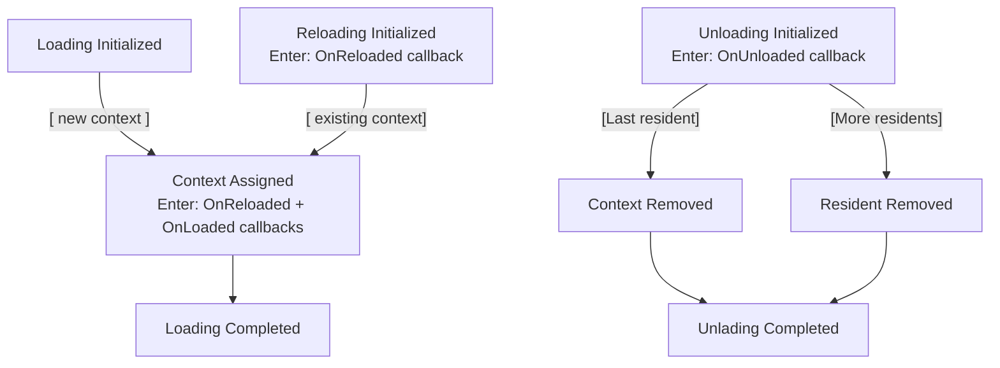

# Script Pipeline

Processing script atachments and detachments is all done by the script pipeline.

In versions prior to `16.0` the pipeline was represented by load unload commands, which atomically processed scripts. Since then the pipeline has been maassively overhauled to allow:
- Customizing callbacks during the process
- Budgeting the work done by the pipeline each frame
- Allowing async steps in the process

The new pipeline works like this:
- A set of systems in `PreUpdate` "filter" incoming `ScriptAttachedMessage` and `ScriptDetachedMessage`'s as well as `ScriptAssetModifiedMessage`'s (some generated from asset events, others from component hooks). The filtered events are wrapped in `ForPlugin<P>(inner)` events based on the language of the underlying event's.
- A set of other systems then converts those into active `ScriptMachine`'s
- Then inside the `ScriptProcessingSchedule<P>`, which is only run in `PreUpdate` if there are active machines, we tick each machine until it either errors or reaches its final state.

## Script Machines

### State Machine
Script loading is handled by the following state machines:


Hooks, such as `on_script_loaded` are implemented using bevy observers. This allows you to hook into various parts of the loading process and add your own callbacks, i.e.:

```rust
fn main(&mut app: App) {
    let machines = app.add_observer(|On<LoadingCompleted<LuaScriptingPlugin>>| todo!("do stuff"));
}
```


## Timing & Order

By default all machines are ticked to completion in the frame they start. Setting `ScriptLoadingPipeline::tick_budget` limits the amount of machine ticks (steps in the state machine above) per frame, spreading the loading of many scripts over multiple frames. The budget counts steps, not time, so a step running a slow callback can still take up the frame.

You can override this and many other settings (including disabling the core callbacks) by changing the `ScriptLoadingPipeline<P>` settings via your scripting plugin's `set_pipeline_settings`.

The script loading/unloading order will look as follows:
- the order in which components are attached/detached, will determing what order scripts will be processed
- an attachment whose script asset is still loading holds back the attachments after it, until it finishes loading
- scripts are processed one-by-one, i.e. each machine is ticked to completion before the next one is started
    - meaning for example if two scripts are loaded, their `on_script_loaded` hooks will not run at the same "lockstep".
- loading/unloading might happen over multiple frames, depending on the pipeline's settings.

## Determinism

Given the same inputs (the same order of attachments, detachments and app updates), scripts load in the same order and callbacks reach scripts in the same order, on every run and machine: script contexts are kept in insertion ordered maps, and the pipeline budget counts steps rather than time.

What BMS cannot control:
- which frame a script asset finishes loading in, as asset IO is asynchronous. Wait for scripts to load (see below) before relying on frame timing.
- language internals, for example Lua iterates tables with string keys (`pairs`) in a different order on each run. BMS seeds Lua's `math.random` with `0` when creating a context, call `math.randomseed` to change it.

## Waiting for scripts to load

In order to check on the pipeline and figure out when everything is ready, you can use the `ScriptPipelineState<P>` system parameter in a system as shown in the `script_loading` [example](https://github.com/makspll/bevy_mod_scripting/blob/main/examples/script_loading.rs).