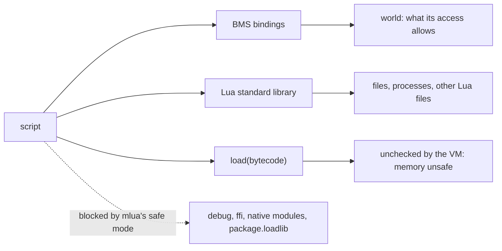

# Customizing Contexts

Most of the time, [registering script functions](./controlling-script-bindings.md) is all you need: they work in every language, and show up in the generated docs. For anything else, scripting plugins take initializers which run on each [context](./contexts.md) or runtime:

| Initializer | Runs |
|---|---|
| `add_context_initializer` | Once a context is created, and when its script is reloaded, before any callbacks |
| `add_context_pre_handling_initializer` | Before every callback, and on load and reload |
| `add_runtime_initializer` | Once, on the runtime shared by all contexts |

Initializers are plain functions (`fn` pointers), so they can't capture variables.

## Context initializers

i.e. setting some globals for every Lua script:

```rust,ignore
let plugin = LuaScriptingPlugin::default().add_context_initializer(|_attachment, context| {
    let globals = context.globals();
    for i in 0..10 {
        globals.set(i, i).map_err(IntoInteropError::to_bms_error)?;
    }
    Ok(())
});

app.add_plugins(plugin);
```

## Pre handling initializers

These receive the attachment of the script about to run, i.e. to expose its name:

```rust,ignore
app.add_plugins(LuaScriptingPlugin::default().add_context_pre_handling_initializer(
    |attachment, context| {
        let name = attachment.script().path().map(|p| p.to_string());
        context
            .globals()
            .set("script_name", name)
            .map_err(IntoInteropError::to_bms_error)?;
        Ok(())
    },
));
```

## Runtime initializers

Some languages have a `runtime`, shared by all contexts, which is customized with `add_runtime_initializer(|runtime| { ... })`. Lua's runtime type is `()`, as `mlua` has no separate runtime.

## Accessing the world

During initializers, the world is available through the `ThreadWorldContainer` thread local:

```rust,ignore
LuaScriptingPlugin::default().add_context_initializer(|_attachment, _context| {
    let world = ThreadWorldContainer::try_get_context()?.world;
    world.with_resource(|res: &MyResource| println!("My resource: {res:?}"))?;
    Ok(())
});
```

## Sandboxing

BMS keeps scripts **memory safe**, it doesn't confine them. By default a script is as trusted as your own code:

| | Lua | Rune |
|---|---|---|
| Files and processes | yes: `io`, `os.execute` | no: only Rune's core modules are installed |
| Loading other code | yes: `require` (Lua files), `dofile`, `load` | no |
| The world | everything the registered functions reach | the same |
| CPU and memory | unlimited: `while true do end` hangs the frame | unlimited |
| Memory safety | yes, **except through bytecode**, see below | yes |



Lua contexts are made with `mlua::Lua::new()`, which leaves out what breaks memory safety outright (`debug`, LuaJIT's `ffi`, native modules). It does **not** stop `load` and `loadstring` from running bytecode, which neither Lua nor LuaJIT verify: `load(string.dump(f))` works, and so does a crafted chunk.

The `unsafe_lua_modules` feature uses `Lua::unsafe_new()` instead: every library, `debug` and `ffi` included. Scripts can then do anything, also to BMS' own values.

### Running scripts you don't trust

Take away what they don't need in a context initializer, which runs before the script is loaded:

```rust,ignore
let plugin = LuaScriptingPlugin::default().add_context_initializer(|_attachment, context| {
    let globals = context.globals();
    // no files, processes, other code, or bytecode
    for name in ["io", "os", "package", "require", "dofile", "loadfile", "load", "loadstring"] {
        globals.set(name, mlua::Nil).map_err(IntoInteropError::to_bms_error)?;
    }
    let string: mlua::Table = globals.get("string").map_err(IntoInteropError::to_bms_error)?;
    string.set("dump", mlua::Nil).map_err(IntoInteropError::to_bms_error)?;
    Ok(())
});
```

Then bound what's left:

- **Memory**: `context.set_memory_limit(bytes)` (not on LuaJIT, which allocates by itself).
- **CPU**: an instruction hook, `context.set_hook(HookTriggers::new().every_nth_instruction(n), ..)`, returning an error once a budget is spent. LuaJIT doesn't call hooks from compiled code.
- **The world**: only register the functions untrusted scripts may call, and give them a [context](./contexts.md) of their own. [Script systems](../ScriptSystems/introduction.md) can only access what they declared.

On LuaJIT, `#[ffi]` functions which panic abort the process, see [LuaJIT internals](../Development/LanguageInternals/luajit.md#safety-checklist).
