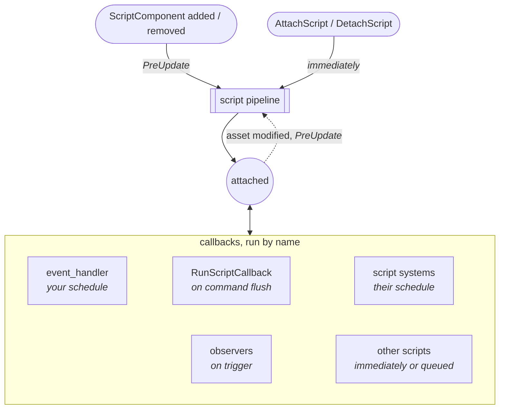
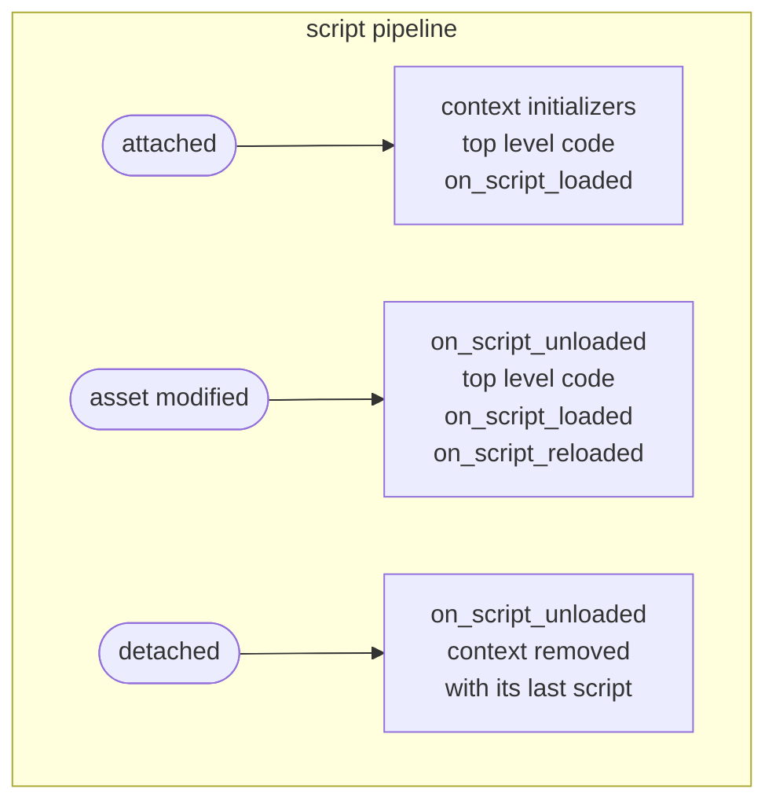

  
  <h1>Bevy Mod Scripting</h1>
  
Script your Bevy game: hot-reloadable Lua &amp; Rune with full ECS access

  

    <a href="Summary/installation.html">Install</a>
    <a href="Summary/managing-scripts.html">User Guide</a>
    <a href="ScriptingReference/introduction.html">Scripting Reference</a>
    <a href="https://github.com/makspll/bevy_mod_scripting">GitHub</a>
  

BMS (`bevy_mod_scripting`) runs Lua and Rune scripts inside a Bevy app. Scripts reach the world through reflection, so any `Reflect` type, including ones from other crates, can be used from scripts without writing glue code.

- Update game logic without recompiling, with hot reloading of script assets
- Let modders add content through the same bindings your own scripts use
- Bindings are written once in Rust and work in every supported language
- Scripts can add their own systems, components and events
- Generated docs and Lua language server definitions for your bindings

## How a script runs

Loading a script asset runs nothing. A script runs code when it is **attached**, reloaded or detached, which the script pipeline handles, and when one of its **callbacks** is invoked by name. The schedule each one runs in is in italics.

### The script pipeline

- The **attachment** (entity + script, or a static script) is the script's identity, see [Managing Scripts](./Summary/managing-scripts.md). Scripts sharing a [context](./Summary/contexts.md) share globals.
- **Callbacks** run the function passed to `register_callback`, else the top level function of that name, see [Running Scripts](./Summary/running-scripts.md) and [Calling Other Scripts](./ScriptingReference/calling-other-scripts.md).
- `on_script_*` are the [core callbacks](./ScriptingReference/core-callbacks.md). `on_script_unloaded` can return state, which `on_script_reloaded` receives.
- Ordering and budgeting are covered in [Script Pipeline](./ScriptPipeline/pipeline.md).

## Where to start

| You are | Read |
|---|---|
| Adding scripting to a Bevy game | [Installation](./Summary/installation.md), then the [User Guide](./Summary/managing-scripts.md) |
| Writing scripts or mods | The [Scripting Reference](./ScriptingReference/introduction.md) |
| Upgrading BMS | The [Release Notes](./ReleaseNotes/guides.md) |
| Contributing to BMS | [Developing BMS](./Development/introduction.md) |
